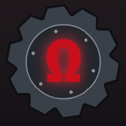
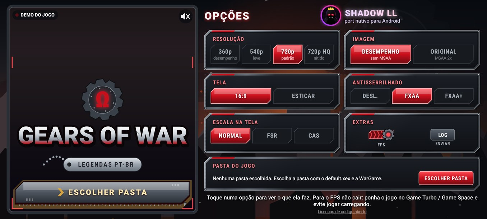
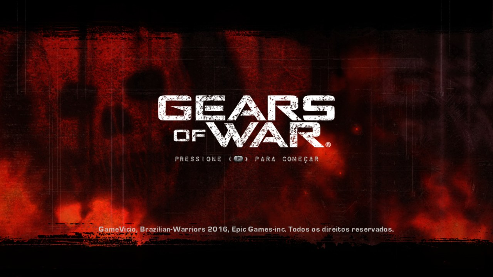
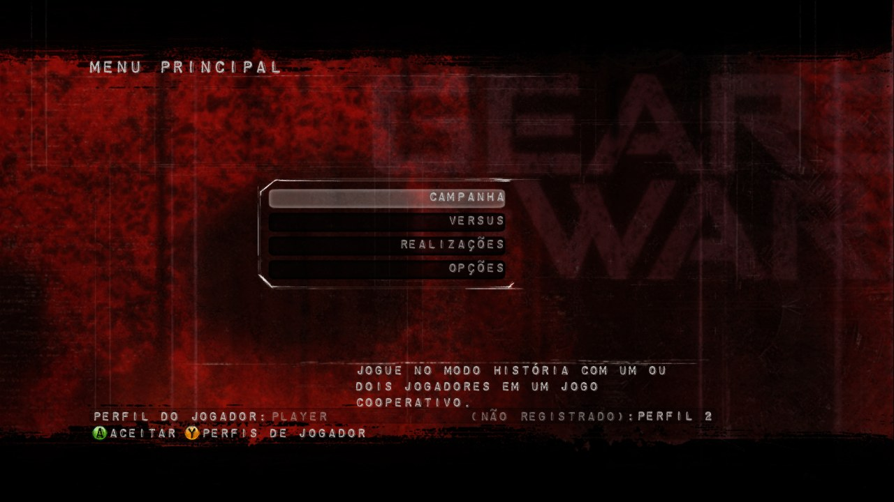
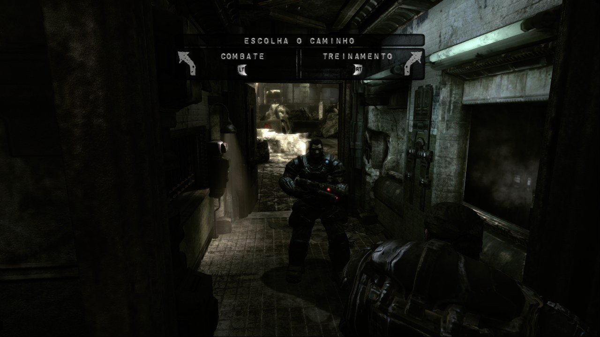
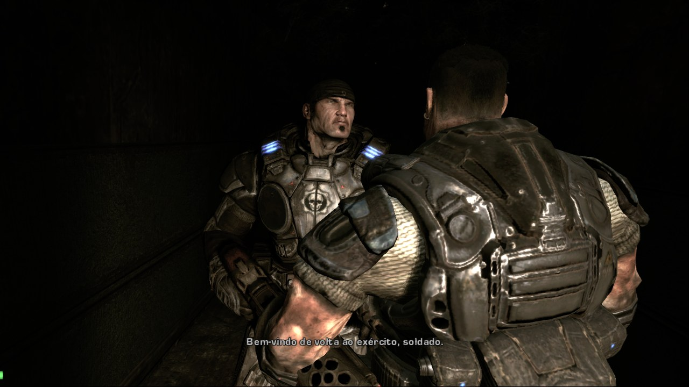

# ⚙️ Gears of War — Port Nativo

**O jogo de Xbox 360 rodando nativamente no Android (ARM64), sem emulador de CPU.**

[**⬇️ Baixar**](../../releases/latest) · [Requisitos](#-requisitos) · [Instalação](#-instalação) · [Configurações](#%EF%B8%8F-configurações) · [Perguntas](#-perguntas-frequentes)

---

## 📖 Sobre

Este port **não é um emulador de Xbox 360**. O executável do jogo (`default.xex`) é **recompilado estaticamente** de PowerPC para ARM64: o resultado é código nativo, que roda direto no processador do celular. A parte gráfica usa um backend Vulkan adaptado para GPUs de celular.

> [!IMPORTANT]
> **O APK não contém nenhum arquivo do jogo.** Você precisa da sua **própria cópia** de *Gears of War* para Xbox 360, na versão indicada em [Versão do jogo](#-versão-do-jogo-obrigatória).

> [!NOTE]
> **Versão em testes.** A campanha roda do começo, com legendas em português, mas o desempenho ainda está sendo ajustado e depende muito do aparelho. Os APKs ainda não foram publicados: eles vão aparecer na página de [**Releases**](../../releases).

### ✨ Destaques

- **Campanha jogável** com as legendas e menus em **português do Brasil**.
- **Menu em uma tela só**, no tema do jogo: placas de armadura, Crimson Omega, JOGAR com dentes de motosserra da Lancer e um efeito para cada opção (Martelo da Aurora, granada, recarga ativa...). O trailer do jogo passa na coluna da esquerda.
- **Imagem "Desempenho":** desliga o MSAA 2x do jogo e usa o modo de renderização de 1 tile do próprio Gears, bem mais leve para a GPU do celular.
- **Resoluções:** 360p, 540p, 720p e 720p HQ.
- **Antisserrilhado FXAA e FXAA+** e **escala FSR 1.0 / CAS** da AMD.
- **Controles na tela** com editor (mover, redimensionar, esconder e ajustar a transparência), além de controles físicos Bluetooth e USB.
- **Drivers de GPU customizados (Turnip)** em celulares **Snapdragon**, importados direto pelo menu.
- **Painel de desempenho:** FPS, resolução e uso de CPU, GPU e RAM.

## 📸 Capturas

| Tela de título | Menu principal |
|:---:|:---:|
|  |  |
| **Campanha** | **Cinemática** |
|  |  |

## 📱 Requisitos

| | Mínimo | Recomendado |
|---|---|---|
| **Android** | 11 (API 30) | 13 ou mais novo |
| **Processador** | ARM64 (arm64-v8a) | Snapdragon 8 Gen 1 / Dimensity 8000 ou superior |
| **GPU** | Vulkan 1.1 | Mali-G710 / Adreno 730 ou superior |
| **RAM** | 4 GB | 8 GB ou mais |
| **Espaço** | os arquivos do jogo (cerca de 6,3 GB) | — |

## 💿 Versão do jogo (obrigatória)

O port é feito para **uma versão específica** do executável. O código é recompilado a partir deste arquivo, então o que vale é o `default.xex` ser **idêntico**: confira o hash abaixo.

| Campo | Valor |
|---|---|
| Jogo | Gears of War (Xbox 360) |
| Title ID | `4D5307D5` |
| Media ID | `76E9DF5B` |
| Versão do executável | `0.0.5.1` |
| Idioma | versão com legendas em português do Brasil (tradução Brazilian Warriors, 2016) |

| Arquivo | Tamanho | SHA-1 | MD5 |
|---|---|---|---|
| `default.xex` | 6.375.424 bytes | `36a909f2bb3a73a65ddec0cf79edc694746bcae6` | `50a28f2fd6beb2239ff7209d507f2aff` |

A pasta do jogo precisa ter o `default.xex` e a pasta `WarGame` ao lado dele.

<b>Como conferir o hash</b>

- **Windows (PowerShell):** `Get-FileHash default.xex -Algorithm SHA1`
- **Linux / macOS:** `sha1sum default.xex`
- **Android:** qualquer app de "hash checker" da Play Store.

## 🚀 Instalação

1. Baixe o **APK** na página de [**Releases**](../../releases/latest) e instale. Talvez seja preciso permitir *"instalar apps de fontes desconhecidas"*.
2. Copie a pasta do jogo para o celular, por exemplo `Armazenamento interno/Gears`.
3. Abra o app e toque em **ESCOLHER PASTA**.
4. Permita o **acesso a todos os arquivos**: o jogo lê os dados direto da pasta, sem copiar nada.
5. Escolha a pasta que contém o `default.xex` e a `WarGame`.
6. Ajuste as configurações e toque em **JOGAR**.

> [!TIP]
> Na primeira vez que cada cena aparece, o jogo compila shaders e pode engasgar um pouco. Nas próximas vezes eles já ficam salvos.

## ⚙️ Configurações

| Opção | O que faz | Impacto no desempenho |
|---|---|---|
| **Resolução 360p / 540p** | Renderiza com menos pixels | 🟢 Mais FPS: ideal para celulares mais fracos |
| **Resolução 720p** | Resolução original do Xbox 360 | ⚪ Padrão |
| **Resolução 720p HQ** | 720p com mais nitidez | 🟠 Pesa um pouco a mais |
| **Imagem: Desempenho** | Sem MSAA, renderização em 1 tile | 🟢 Bem mais leve |
| **Imagem: Original** | MSAA 2x, como no Xbox 360 | 🔴 Mais pesado |
| **Tela: 16:9 / Esticar** | Mantém a proporção original ou estica para a tela toda | ⚪ Nenhum |
| **Antisserrilhado: FXAA / FXAA+** | Suaviza as bordas serrilhadas | 🟠 Pesa um pouco a mais |
| **Escala na tela: FSR / CAS** | Amplia a imagem com mais nitidez (AMD FidelityFX) | 🟠 Pesa um pouco a mais |
| **FPS** | Mostra FPS, resolução, CPU, GPU e RAM | ⚪ Quase nenhum |
| **Driver da GPU** (só Snapdragon) | Usa o driver do sistema ou um driver **Turnip** importado (`.zip` no formato AdrenoTools) | Depende do aparelho e do driver |

> [!NOTE]
> Se o FPS cair, use **Imagem: Desempenho**, **Antisserrilhado: Desl.** e **Escala: Normal**, e baixe a resolução. Ponha o jogo no Game Turbo / Game Space do celular e evite jogar carregando.

## 🎮 Controles

| Botão | Ação | Botão | Ação |
|---|---|---|---|
| **Analógico esquerdo** | Andar | **Analógico direito** | Olhar |
| **LT** | Mirar | **RT** | Atirar |
| **RB** | Recarregar (recarga ativa) | **LB** | Mapa tático / comunicação |
| **A** | Cobertura, mergulhar, correr (segurar) | **B** | Corpo a corpo (motosserra) |
| **X** | Interagir / pegar | **Y** | Olhar rápido |
| **Direcional** | Trocar de arma | | |

- **Controles na tela:** toque na engrenagem **⚙** no topo para mover, redimensionar ou esconder cada botão e ajustar a transparência.
- **Controle físico:** controles Bluetooth e USB compatíveis com Android são reconhecidos automaticamente.

## ❓ Perguntas frequentes

<b>O jogo fecha ao abrir / tela preta</b>

- Confira se o `default.xex` bate com o hash acima.
- Confira se a permissão de **acesso a todos os arquivos** foi dada.
- Confira se a pasta escolhida é a que contém o `default.xex` e a `WarGame`, e não uma pasta acima dela.
- Se você trocou o **Driver da GPU**, volte para **Sistema**.

<b>Dá para jogar a 60 FPS?</b>

Não. O próprio jogo é travado em 30 FPS, como no Xbox 360.

<b>Tem dublagem em português?</b>

Não. A versão suportada traz só as legendas e os menus em português; as vozes são as originais em inglês.

<b>Funciona com outra versão ou região do disco?</b>

Só se o `default.xex` for **idêntico** (mesmo SHA-1 da tabela). Com hash diferente, não funciona.

<b>O código-fonte está disponível?</b>

Não. Este é um projeto de código fechado. Os componentes de código aberto usados estão listados abaixo, com as respectivas licenças.

## 🙏 Créditos

Este projeto só foi possível graças a estes projetos de código aberto:

- [**XenonRecomp**](https://github.com/hedge-dev/XenonRecomp): recompilador estático de PowerPC (Xbox 360)
- [**Xenia Canary**](https://github.com/xenia-canary/xenia-canary): referência do hardware do Xbox 360 e base do backend Vulkan
- [**SDL 3**](https://github.com/libsdl-org/SDL): janela, entrada e áudio
- [**FFmpeg**](https://ffmpeg.org): decodificação de áudio XMA
- [**AMD FidelityFX FSR / CAS**](https://github.com/GPUOpen-Effects): escala e nitidez
- [**libadrenotools**](https://github.com/bylaws/libadrenotools): drivers de GPU customizados no Android

As licenças completas estão em [THIRD_PARTY_NOTICES.md](THIRD_PARTY_NOTICES.md).

## ⚖️ Aviso legal

Este é um projeto de fãs, **sem fins lucrativos**, sem nenhuma ligação com a Epic Games, a Microsoft, a Xbox Game Studios ou a The Coalition. *Gears of War* é marca e obra de seus respectivos donos.

O APK **não inclui** arquivos, vídeos, sons ou texturas do jogo: é preciso ter a sua própria cópia original. Não peça nem compartilhe arquivos do jogo nas issues.

---

Feito com 🧡

